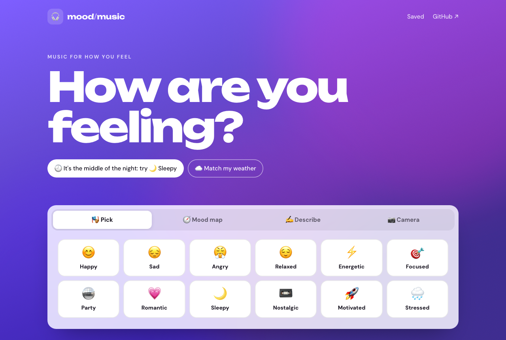
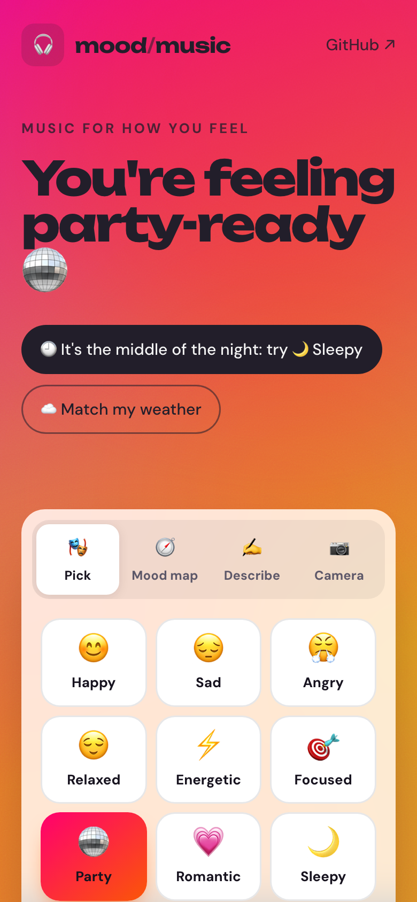
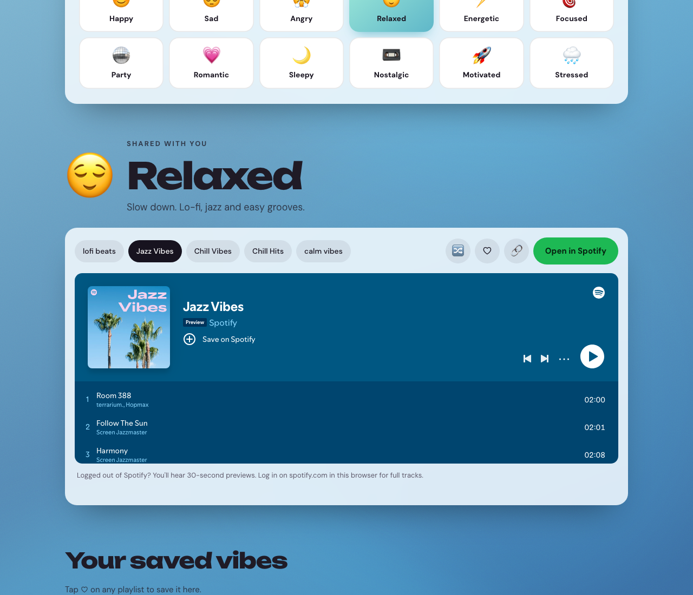

# 🎧 Mood Music

**Music for how you feel.** Pick a mood, drag a dot across a mood map, describe your day in a sentence, or let your face decide, and get a real Spotify playlist that plays right on the page.

[](https://sambit1110.github.io/mood-music-recommender/)


[](LICENSE)

👉 **Try it:** https://sambit1110.github.io/mood-music-recommender/

<p align="center">
  
  
</p>
<p align="center">
  
</p>

---

## ✨ Features

**Four ways to tell it how you feel**
- 🎭 **Pick:** 12 moods: Happy, Sad, Angry, Relaxed, Energetic, Focused, Party, Romantic, Sleepy, Nostalgic, Motivated and Stressed.
- 🧭 **Mood map:** drag a dot across a 2D map (down ↔ up, calm ↔ energetic) and it finds the closest mood. Works with the keyboard too.
- ✍️ **Describe your day:** type something like *"exams tomorrow and I'm so stressed"* and it detects the mood in your browser, explaining which words it used. Handles negation (*"not happy"*, *"can't sleep"*), boosters and emoji.
- 📷 **Camera (optional):** reads your facial expression for ~2 seconds with an on-device model. No image is uploaded, and the camera turns off straight away.

**Smart suggestions**
- 🕘 **Time-aware:** suggests a vibe for the time and day (late night → Sleepy, Friday evening → Party…).
- ☁️ **Weather-aware:** one tap matches your local weather (rainy → Relaxed, clear night → Romantic…). Uses the free, keyless [Open-Meteo](https://open-meteo.com) API, with location rounded to ~10 km.

**Listening**
- ▶️ **Plays on the page** with Spotify's embedded player. No login or API key needed (logged-out visitors hear 30-second previews).
- 🎶 **48 hand-checked playlists**, 3–5 per mood, with a 🔀 **shuffle** button.
- ♥ **Save favourites** and see **recently played moods** (stored in your browser).
- 🔗 **Share links:** `?mood=happy&p=2` opens the exact mood and playlist.

**Feel**
- 🎨 The whole page changes colour with your mood: animated gradient, drifting colour blobs and a matching browser theme colour.
- 📱 Fully responsive, keyboard accessible, and respects *reduce motion*.

---

## 🎶 Moods and playlists

| Mood | Example playlists |
|---|---|
| 😊 Happy | Happy Hits!, Mood Booster, Good Vibes |
| 😔 Sad | Sad Songs, Sad Indie, sad hour |
| 😤 Angry | Kickass Metal, VOLUME, Walk Like A Badass |
| 😌 Relaxed | lofi beats, Jazz Vibes, Chill Vibes |
| ⚡ Energetic | Power Workout, Beast Mode, mint |
| 🎯 Focused | Deep Focus, Brain Food, Instrumental Study |
| 🪩 Party | Dance Party, Dance Hits, Happy Beats |
| 💗 Romantic | Love Pop, Soft Pop Hits, A Perfect Day |
| 🌙 Sleepy | Sleep, Deep Sleep, Peaceful Piano |
| 📼 Nostalgic | All Out 90s, All Out 2000s, All Out 80s |
| 🚀 Motivated | Confidence Boost, Feelin' Good, RapCaviar |
| 🌧️ Stressed | Stress Relief, Rainy Day Jazz, Chill Tracks |

The full list lives in [`js/moods.js`](js/moods.js). To add a playlist, paste its Spotify ID into the mood's `playlists` array.

---

## 🛠 Tech stack

- **HTML, CSS, JavaScript (ES modules)**: no framework, no build step.
- **Spotify embeds** for playback.
- **Open-Meteo** for weather (no key).
- **[face-api](https://github.com/vladmandic/face-api)** (TensorFlow.js) for optional on-device expression detection, loaded only when you use the camera.
- **GitHub Pages** for hosting.

---

## 📂 Project structure

```
mood-music-recommender/
├── index.html          # page structure
├── css/
│   └── style.css       # design, mood-reactive theme, responsive layout
├── js/
│   ├── app.js          # UI: picker, map, results, player, favourites, sharing
│   ├── moods.js        # 12 moods: colours, map position, keywords, playlists
│   ├── detect-text.js  # "describe your day" mood detection
│   ├── weather.js      # time-of-day and weather suggestions
│   └── camera.js       # optional on-device facial expression detection
├── screenshots/        # images used in this README
├── LICENSE
└── README.md
```

---

## 🚀 Run it locally

ES modules need a local server (they don't load from `file://`):

```bash
python3 -m http.server 8000
```

Then open http://localhost:8000.

---

## 🔒 Privacy

- No accounts, no tracking, no backend. Favourites and history stay in your browser's local storage.
- Text you type is analysed on your device and never sent anywhere.
- The camera feature runs entirely on your device. No image leaves the browser.
- The weather feature only runs when you tap it, and sends a location rounded to ~10 km to Open-Meteo.

---

## 🧠 What I learned

- DOM manipulation, events and accessible widgets (tabs, radio groups, a 2D slider)
- ES modules and lazy-loading heavy features on demand
- Simple rule-based NLP with negation handling
- Running a TensorFlow.js model in the browser
- Working with public APIs (Open-Meteo) and embeds (Spotify)
- Responsive, mood-reactive UI with animated CSS custom properties

---

## 🔮 Ideas for later

- Spotify sign-in to build a personal playlist from your mood
- Mood journal with a weekly chart
- More languages for "describe your day"

---

## 🤝 Contributing

Issues and pull requests are welcome. Fork the repo, make your change, and open a PR.

## 📄 License

[MIT](LICENSE)

### ⭐ If you like this project, give it a star!
